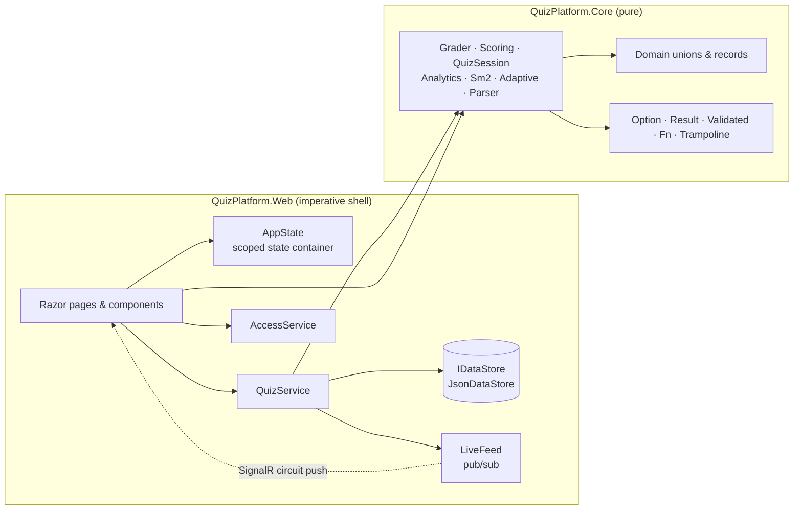
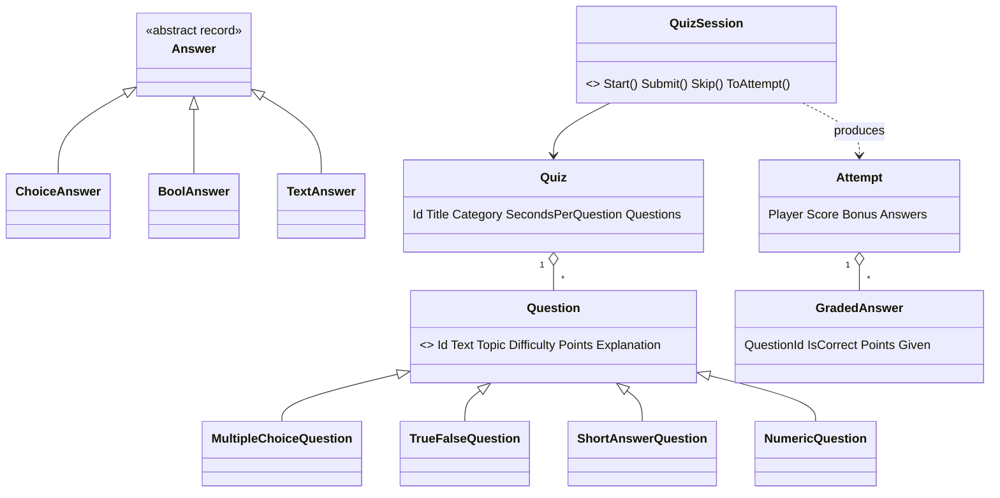
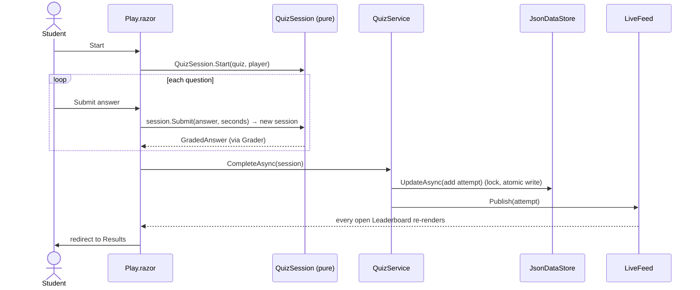

# Architecture

## Style: functional core, imperative shell
All decisions (grading, scoring, SM-2 scheduling, adaptive difficulty, ranking, parsing, validation) are **pure functions
over immutable data** in `QuizPlatform.Core`. Everything impure (files, clock, random, UI events, DI) lives in the thin
`QuizPlatform.Web` shell. Consequences: the core is trivially testable, thread-safe and reusable (e.g. in a MAUI/WASM client).

## Domain model (UML)

## Taking a quiz (sequence)

## Design decisions
| Concern | Decision | Why |
|---|---|---|
| Union types | abstract record + sealed nested records, private ctor | closed hierarchy, exhaustive `switch`, structural equality, `with` |
| Errors | `Result` (fail fast), `Validated` (accumulate), exceptions only for the unexpected | expected failures are data; teachers see all quiz errors at once |
| State | `AppState` scoped state container + `Changed` event + `StateAwareComponent` base; cascading `ToastApi` | consistent UI across components, no leaks (unsubscribe on dispose) |
| Persistence | immutable `AppData` snapshot; reads lock-free; writes serialized, atomic (temp + move) | consistent reads, no torn files, corruption recovery |
| Real time | in-process `LiveFeed` over Blazor Server's SignalR circuits | zero extra infrastructure; handler failures isolated |
| Security | name validation, teacher code (constant-time compare), server-side permission checks, Blazor's HTML encoding, antiforgery | RBAC cannot be bypassed from the client |
| SOLID | `IDataStore`/`IClock` abstractions injected; single-purpose pure modules; open for new question kinds by adding a case | testability, replaceable storage |

## Scalability and efficiency notes
* Reads never block (immutable snapshot). Writes are serialized, which is fine for a classroom/department; the `IDataStore`
  interface is the seam for swapping in SQL/EF Core or Redis without touching the core or the UI.
* Blazor Server keeps one circuit per tab: memory is O(connected users). Prerender is disabled to avoid double initialisation; timers use
  a single `PeriodicTimer` per question and are cancelled on dispose.
* Leaderboard/analytics are LINQ over in-memory arrays — O(n log n) in attempts; adequate for tens of thousands of attempts.
  For larger volumes: move to a database with indexed queries and cache the leaderboard.
* Horizontal scaling would need a shared store and a backplane for `LiveFeed` (e.g. Azure SignalR / Redis).
